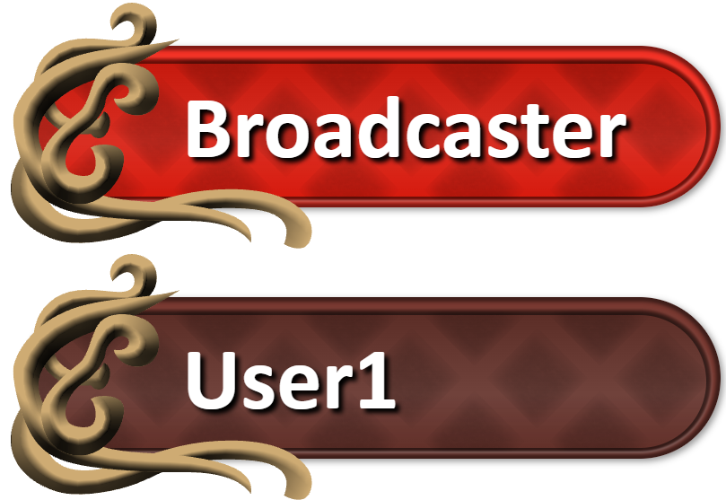
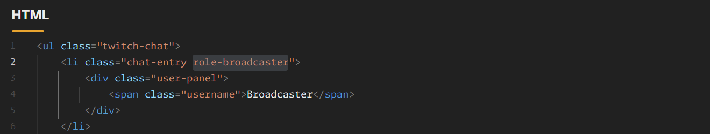
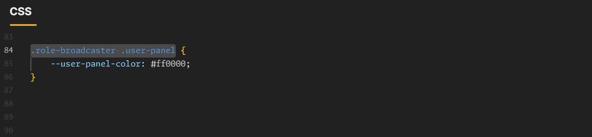

# ryza-chat
Creating a Twitch-integrated chat overlay which is stylized after the dialog boxes from Atelier Ryza

## Reference:

## Progress:
Restyled the user panel to allow for role-based recoloring

## JSFiddle:
[ryza-chat 0.04](https://jsfiddle.net/nelmel_dev/mdL6e89z/)