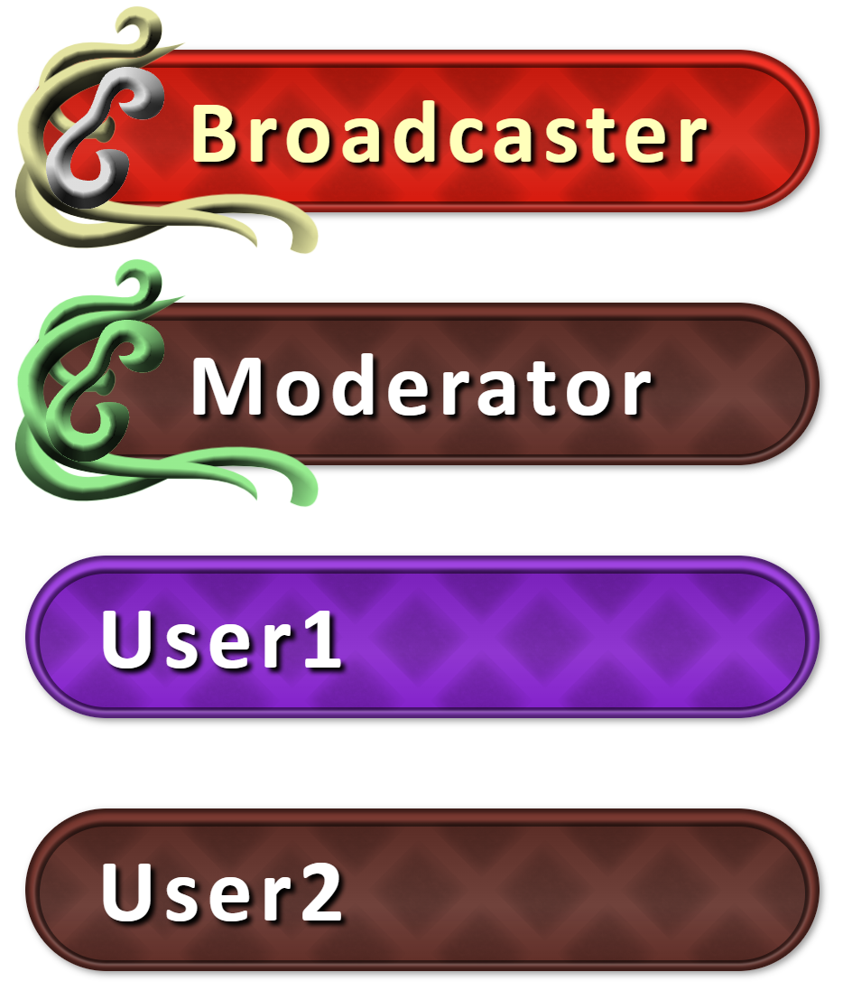
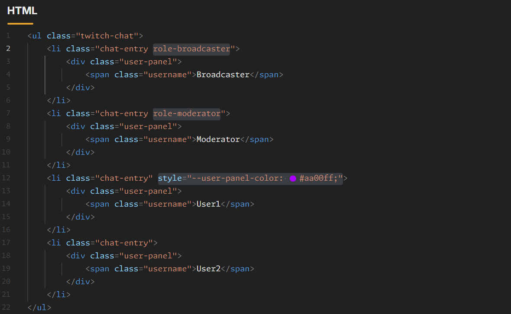
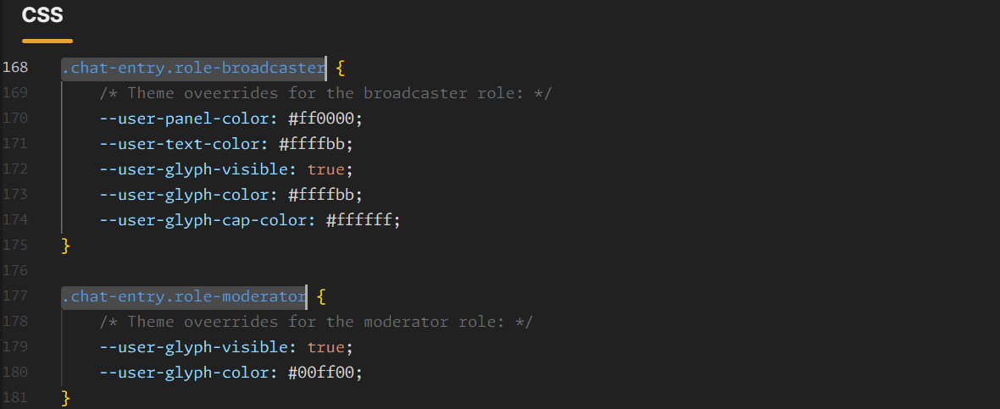

# ryza-chat
Creating a Twitch-integrated chat overlay which is stylized after the dialog boxes from Atelier Ryza

## Reference:

## Progress:
Restyled remaining elements of the user panel to allow for role-based and item-level theming

## JSFiddle:
[ryza-chat 0.05](https://jsfiddle.net/nelmel_dev/2hstcg58/)