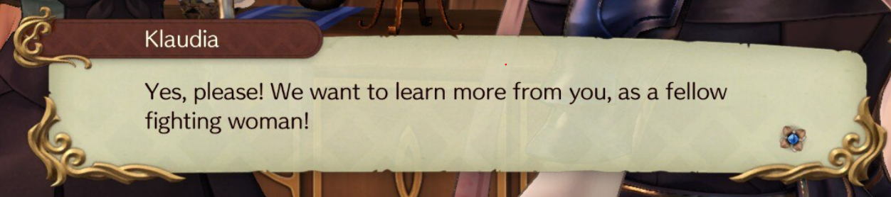
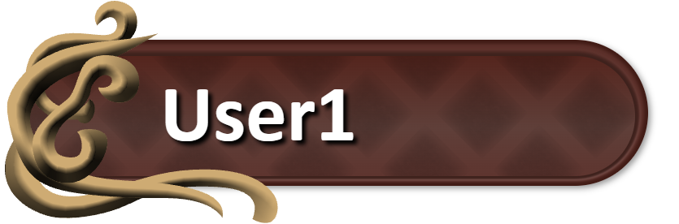

# ryza-chat
Creating a Twitch-integrated chat overlay which is stylized after the dialog boxes from Atelier Ryza

## Reference:

## Progress:
Added initial shading to use glyph and switched to Calibri font

## JSFiddle:
[ryza-chat 0.03](https://jsfiddle.net/nelmel_dev/cnkxtm8y/)